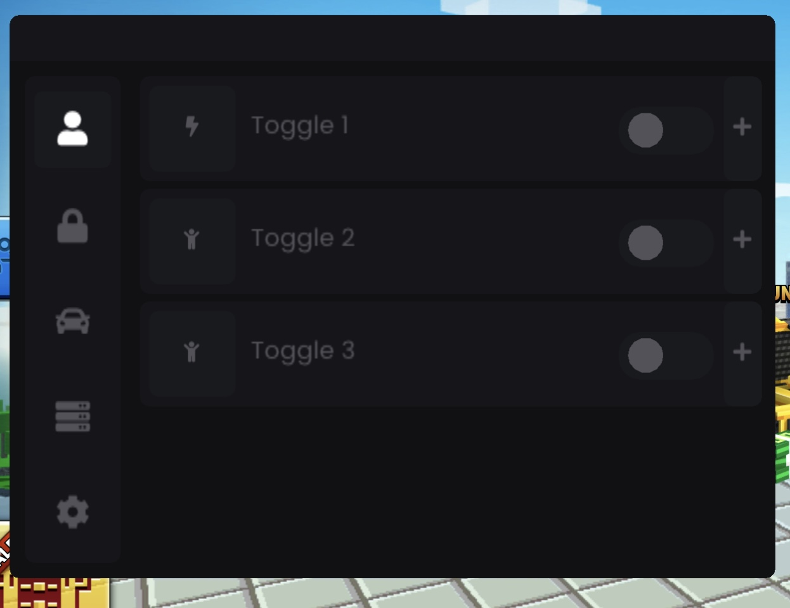

# ZingSpeedTweakIOS

> **ZingSpeed Mobile iOS Mod Menu (ImGui Metal)**  
> Menu mod/hack tweak cho tựa game **ZingSpeed Mobile VN (`vn.vng.zsmvn`)** trên hệ điều hành iOS (Jailbreak & Non-Jailbreak / Jailed).  
> **Tác giả:** [Zhee Dev](https://github.com/zheedevVn)

---



## 📌 Giới thiệu (Overview)

**ZingSpeedTweakIOS** là dự án iOS tweak mod menu sử dụng giao diện **Dear ImGui** tối ưu bằng **Apple Metal Framework**, hỗ trợ can thiệp bộ nhớ Unity và hook chức năng trong game ZingSpeed Mobile mà không cần JIT.

- **Bundle ID hỗ trợ:** `vn.vng.zsmvn` (ZingSpeed Mobile VNG)
- **Kiến trúc:** `arm64` (iOS 13.0+)
- **Hỗ trợ thiết bị:** Cả máy đã Jailbreak (cài file `.deb`) và máy chưa Jailbreak (inject `.dylib` qua Sideloadly / TrollStore / Esign / Scarlet).

---

## ⚡ Các tính năng nổi bật (Features)

### 🏎️ Tab Cơ Bản (Racing Cheats)
- **Auto Đua Lập Trình (Auto Race):** Tự động bám đường hướng dẫn hoặc tự ra giữa đường (Map ID 157 Hồ Long Tỉnh,...).
- **Vô Hạn Nitro (Infinite Nitro):** Luôn duy trì lượng nitro tối đa.
- **Gia Tốc (Speed Acceleration):** Tăng tốc độ tối đa của xe đua.
- **Mini Boot (Super Mini Boost):** Tăng tốc mini boost liên tục.
- **ECU 3 Lượt:** Mở rộng số lần kích hoạt tính năng ECU.
- **Teleport Auto / Teleport Button:** Di chuyển tức thời đến các điểm mốc trên đường đua.
- **Thoát Nhanh (Fast Exit):** Rời trận nhanh chóng.
- **Nitro Nhanh:** Hồi nitro siêu tốc.

### 👤 Tab Nhân Vật & Xe (Player & Kart)
- **Ký Sinh (Parasite):** Ghép và đồng bộ xe mục tiêu.
- **Fake Tên:** Ẩn hoặc đổi tên ingame.
- **Mod Skin & Xe:** Mở khóa hiển thị xe và skin yêu thích.
- **Mod Chỉ Số Xe:** Tùy biến thông số hiệu năng xe.

### ⚙️ Tab Cài Đặt (Settings & System)
- **Light / Dark Theme:** Tùy chọn giao diện sáng / tối mượt mà.
- **Streamer Mode:** Chống quay lén màn hình menu khi livestream/quay video màn hình qua textfield bảo mật.
- **Menu Logs:** Bảng log trực tiếp trong menu để debug.
- **Thông tin tác giả:** Hiển thị thông tin phiên bản và tác giả **Zhee Dev**.

---

## 🛠️ Yêu cầu & Cài đặt (Requirements & Build)

### 1. Build tự động qua GitHub Actions (Khuyên dùng)
Dự án đã tích hợp sẵn GitHub Actions workflow [`.github/workflows/build.yml`](.github/workflows/build.yml):
1. Nhấn nút **Star** và **Fork** repository này về tài khoản GitHub của bạn.
2. Vào tab **Actions** trên GitHub repo của bạn.
3. Chọn workflow **Build ZingSpeedTweakIOS** và nhấn **Run workflow**.
4. Sau khi hoàn thành (khoảng 2-3 phút), tải file `.deb` thành phẩm tại mục **Artifacts** (`ZingSpeedTweakIOS-Deb`).

### 2. Build thủ công trên máy tính (macOS / Linux với Theos)
Cài đặt [Theos](https://theos.dev):
```bash
git clone --recursive https://github.com/theos/theos.git $HOME/theos
export THEOS=$HOME/theos
export PATH=$THEOS/bin:$PATH

# Biên dịch gói .deb:
make clean package FINALPACKAGE=1
```
Gói `.deb` sẽ được xuất ra trong thư mục `packages/`.

---

## 📲 Hướng dẫn cài đặt vào Game (Installation Guide)

### Cách 1: Thiết bị đã Jailbreak
1. Chép file `.deb` vào thiết bị qua Filza File Manager.
2. Nhấn vào file `.deb` và chọn **Install** (Cài đặt).
3. Mở game **ZingSpeed Mobile** và chạm vào nút menu tròn để mở giao diện.

### Cách 2: Thiết bị chưa Jailbreak (TrollStore / Sideloadly / Esign)
1. Giải nén file `.deb` để lấy file `ZingSpeedTweakIOS.dylib` (trong `Library/MobileSubstrate/DynamicLibraries/`).
2. Tải file `.ipa` gốc của **ZingSpeed Mobile VN**.
3. Sử dụng Sideloadly / TrollStore / Esign để chèn (inject) `ZingSpeedTweakIOS.dylib` và `libdobby_fixed.a` vào file `.ipa`.
4. Cài đặt và mở game trải nghiệm.

---

## 👨‍💻 Tác giả & Bản quyền (Author & Credits)

- **Author / Developer:** [Zhee Dev (@zheedevVn)](https://github.com/zheedevVn)
- **Repository:** [https://github.com/zheedevVn/ZingSpeedTweakIOS](https://github.com/zheedevVn/ZingSpeedTweakIOS)
- **Giao diện ImGui:** Dựa trên template ImGui Metal iOS, được tinh chỉnh và tùy biến bởi **Zhee Dev**.

---

## ⚠️ Tuyên bố miễn trừ trách nhiệm (Disclaimer)

Dự án này được phát triển chỉ nhằm mục đích nghiên cứu học tập kỹ thuật dịch ngược (reverse engineering) và lập trình đồ họa Metal trên iOS. Tác giả không chịu trách nhiệm đối với bất kỳ hành vi lạm dụng nào vi phạm điều khoản dịch vụ của nhà phát hành game.
